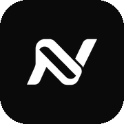
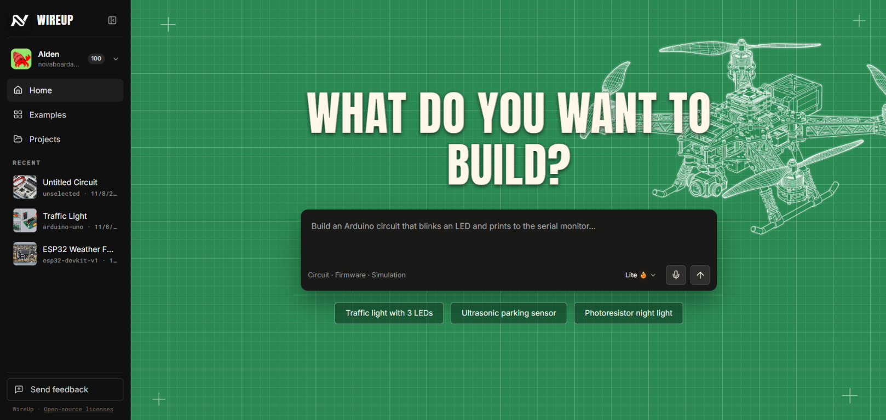
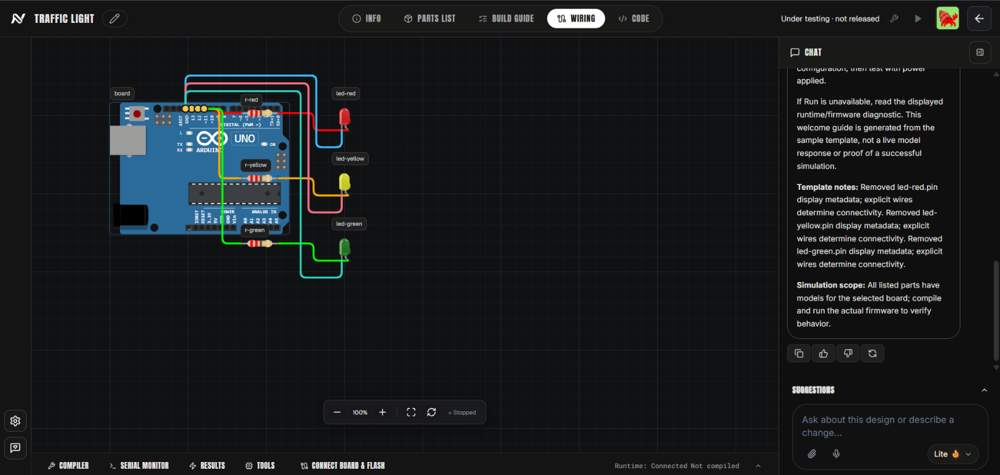
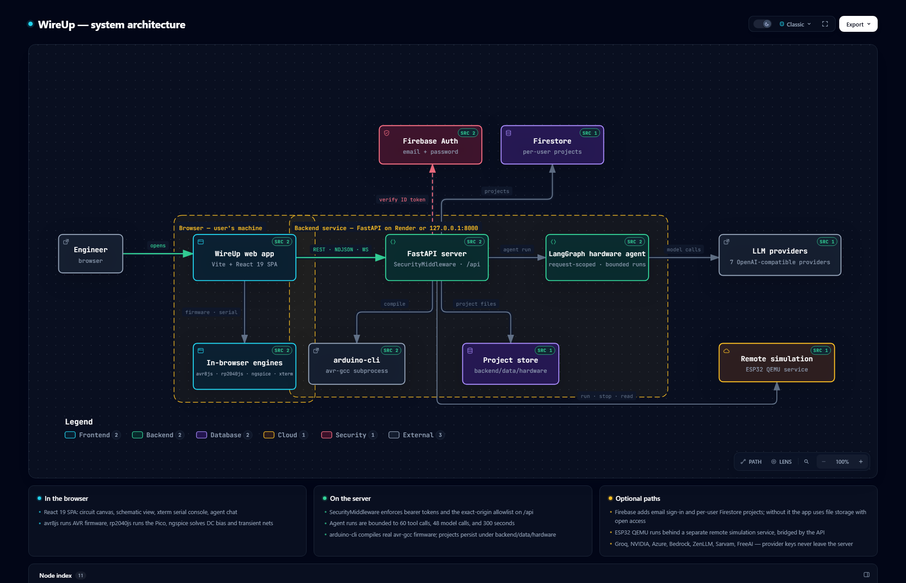
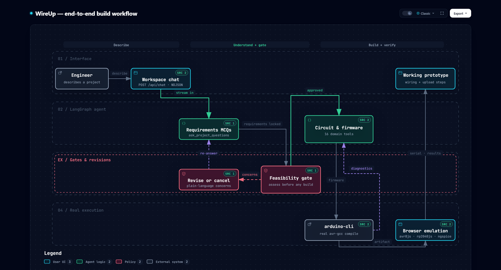

<div align="center">



# WireUp

**Describe it. Wire it. Compile it. Simulate it.**

[](backend/requirements.txt)
[](backend/app.py)
[](backend/agent.py)
[](frontend/package.json)
[](frontend/tsconfig.app.json)
[](frontend/vite.config.ts)
[](#tests)
[](#license)

</div>

A browser-based hardware prototyping platform. Describe a circuit in plain language and an AI agent
builds it on a live canvas with you. The result compiles as real Arduino firmware, runs in browser
emulation, and can be analyzed with SPICE before anything touches physical hardware.

The repo is a monorepo:

- `frontend/` — Vite + React + TypeScript app: circuit canvas, schematic view, serial console, and
  WASM engines for AVR, RP2040, and ngspice
- `backend/` — FastAPI service: LangGraph hardware agent, arduino-cli compilation, project storage,
  admin console
- `vendor/velxio/` — upstream Velxio source this project was built from (see License)

## Preview

**Home** — start a prototype from a natural-language prompt or one of the starter ideas. The sidebar
keeps recent projects close, while the blueprint grid and drone artwork frame the build prompt.



**Workspace** — circuit canvas, catalog, serial console, and the project's agent side by side.



## Architecture

Two maps of the project, generated from the source itself — every node carries links to the exact
files and lines it is based on. Each has an interactive version (`docs/architecture.html`,
`docs/workflow.html`): a standalone HTML file you can download and open in a browser to pan, zoom,
and switch guided views.

**System map** — components, trust boundaries, and data flow:



**Build workflow** — from a plain-language description to a working prototype:



## Quick start

Requires Node 20+, Python 3.14, and [uv](https://docs.astral.sh/uv/).

```powershell
npm install --prefix frontend
uv venv
uv pip install -r backend/requirements.txt
uv pip install -r backend/requirements-stt.txt
npm run dev
```

Open http://127.0.0.1:5173. The frontend and backend start together (backend on port 8000);
`npm run dev:web` and `npm run dev:api` run them separately. Without uv, use `python -m venv` and
install the requirements with that environment's pip — the npm launcher detects both Windows and
Unix venv layouts.

Real firmware compilation needs the Arduino CLI on your PATH, or set `ARDUINO_CLI_PATH` to its
location. Everything else — emulation, SPICE analysis, the agent — works without it.

## AI providers

Model keys live in the root `.env` and never leave the server. Do not use `VITE_`-prefixed key
variables; anything prefixed that way ships to the browser bundle.

```dotenv
GROQ_API_KEY=
GROQ_MODEL=openai/gpt-oss-120b
NVIDIA_API_KEY=
NVIDIA_MODEL=z-ai/glm-5.3
```

Supported providers: Groq, NVIDIA, Azure OpenAI, Amazon Bedrock, ZenLLM, Sarvam, and FreeAI. Any
provider with a key appears in the chat model selector; the choice is remembered per browser and can
be switched mid-conversation. Key changes apply on the next request. `backend/.env.example`
documents every variable, including Azure and Bedrock setup, token caps, and base URL overrides.

## The agent

The backend runs a request-local LangGraph agent with 23 registered tools for project planning,
component search and editing, wiring and validation, firmware, compilation, simulation, diagnostics,
example references, and calculations. The agent exposes only the tools appropriate to the current
request and project state. Calls go through the same services as the manual controls, so the activity
feed reports the operations that actually ran.

The flow: describe the project → the agent asks multiple-choice questions to pin down
requirements → it assesses feasibility against the component catalog before building anything (you
can revise or cancel) → it builds the circuit and firmware, streaming each tool call to the activity
feed → the final message includes parts, exact wiring, and upload steps.

Runs are bounded to 60 tool calls, 48 model calls, and 300 seconds.

## Boards and simulation

| Board | Compilation | Emulation |
| --- | --- | --- |
| Uno / Nano / Mega | avr-gcc via Arduino CLI | AVR WASM (avr8js) |
| Pico / Pico W | — | RP2040 WASM (rp2040js); Pico W has no wireless or onboard LED |
| ESP32 family | Arduino CLI (large core install) | Experimental; the browser adapter fails its firmware smoke test, and QEMU runs through the remote simulation service |

Serial output, pin monitoring, and an oscilloscope/logic analyzer work against the emulated boards.
The analog catalog includes voltage and current sources, passives, and grounds; DC bias and transient
analysis run real ngspice in the browser. AC sweep is not implemented.

## Examples and starters

All 321 upstream Velxio examples are analyzed in `backend/templates/example-analysis.json` with their
board, pin, and library requirements. The `/examples` page is a searchable, board-filtered gallery.
Six of them (button, LED, and blink starters for Uno, Nano, Mega, and Pico) open as prewired projects
with working firmware and a template-derived setup guide, so they work without any model key.

## Deployment

The frontend and backend deploy as two separate Vercel projects. Set the frontend project's Root
Directory to `frontend` and the backend project's Root Directory to `backend`; each directory has
its own `vercel.json`. Set `VITE_API_BASE_URL` on the frontend to the backend project's HTTPS URL,
and set `WIREUP_ALLOWED_ORIGINS` on the backend to the frontend project's exact HTTPS origin.
Set `WIREUP_DEPLOYMENT=production` and the Firebase and provider secrets on the backend project.
Details and the limits of the serverless API are in `docs/VERCEL_DEPLOYMENT.md`.

`render.yaml` remains a separate always-on backend blueprint. Use it only if the API should not
run as a Vercel function.

Provider key updates in Admin → API Keys are checked against the provider's model-list endpoint
before WireUp activates them. WireUp can disable or retire its copy of a key, but cannot revoke it
at the provider. Chat model requests must match an active Lite, Max, or Ultra assignment. Register
and price a model in Admin → Models before assigning it to a tier.

On Vercel, project files under `backend/data/` do not persist between invocations, and firmware
compile, local QEMU, and USB flashing stay on a machine with those tools. A free Render service,
if you use that blueprint instead, sleeps after about 15 minutes without traffic.

## Firebase authentication and project isolation

Firebase authentication is required for every user-facing project operation. Projects are private to
the Firebase UID that created them; anonymous requests, shared server tokens, and ownerless legacy
projects cannot access the project API. Configure Firebase before creating or opening projects:

1. Create a project at console.firebase.google.com.
2. Enable Email/Password under Authentication → Sign-in method.
3. Create a Firestore database in production mode.
4. Generate a service account key under Project settings → Service accounts and save it as
   `firebase-service-account.json` in the repo root (gitignored). On Render, set
   `FIREBASE_SERVICE_ACCOUNT_JSON` instead.
5. Put the web app config into `VITE_FIREBASE_API_KEY`, `VITE_FIREBASE_AUTH_DOMAIN`,
   `VITE_FIREBASE_PROJECT_ID`, and `VITE_FIREBASE_APP_ID`.
6. Set `FIREBASE_PROJECT_ID` on the backend (or use the service account's project ID) so it can
   verify Firebase ID tokens. Configure the service account as above to persist projects in Firestore.

The `VITE_FIREBASE_*` values are public client identifiers; access control is enforced server-side by
token verification and exact owner UID checks. Without Firebase client configuration, the app blocks
project pages and the backend returns 401 for project operations; there is no anonymous shared project
pool.

## Optional Redis cache

An Upstash Redis cache mirrors recomputable API responses. Set `UPSTASH_REDIS_REST_URL`,
`UPSTASH_REDIS_REST_TOKEN`, and `REDIS_ENABLED=true` to enable it, or leave them empty to run without
it. Details in `REDIS_INTEGRATION.md`.

## Admin console

`/admin` is a server-side ops console covering users, projects, credits, feature flags, model
controls, and the audit log. Sign-in uses `WIREUP_ADMIN_EMAIL` and `WIREUP_ADMIN_PASSWORD` plus a
6-digit code emailed through Resend, so both need to be configured before the console is usable.

## Tests

```powershell
npm run build             # frontend type-check + build
npm run lint
npm run test:api          # pytest, backend
npm test -- --workers=1   # Playwright against real Chrome
```

Backend tests separate injected model responses from real compiler, emulator, and SPICE execution, so
they pass without provider keys. Playwright tests need Chrome installed.

## Production boundaries

Project API requests require Firebase user authentication and scope projects to the owning Firebase
UID. Broader public deployment still requires compiler sandboxing for untrusted source, durable cloud
storage, and WebSocket auth tickets. `docs/RELEASE_STATUS.md` tracks what is verified versus what
blocks a public release.

## License

Velxio, the upstream project preserved under `vendor/velxio`, is dual-licensed AGPLv3 / commercial,
pinned at revision `3e45cad`. Network deployments must comply with the applicable license;
closed-source use requires a commercial license. See `vendor/VELXIO_PROVENANCE.md` and
`COMMERCIAL_LICENSE.md`.
